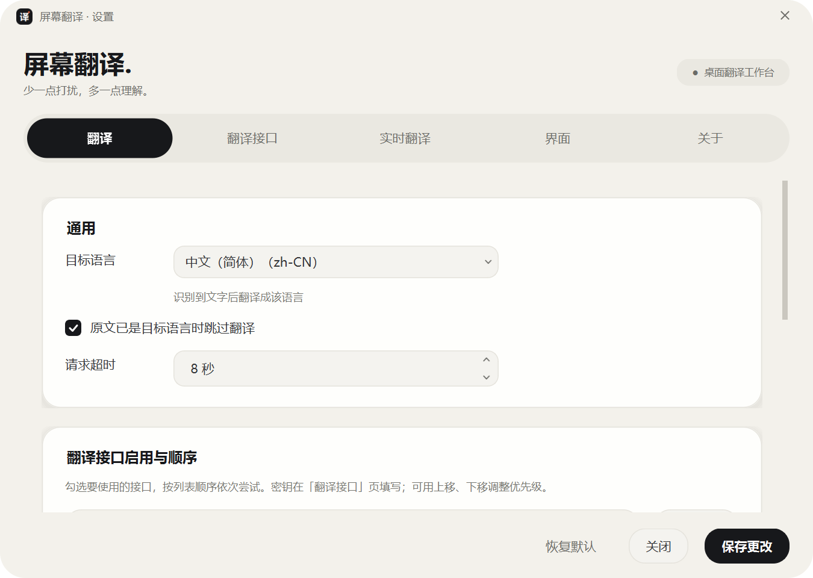
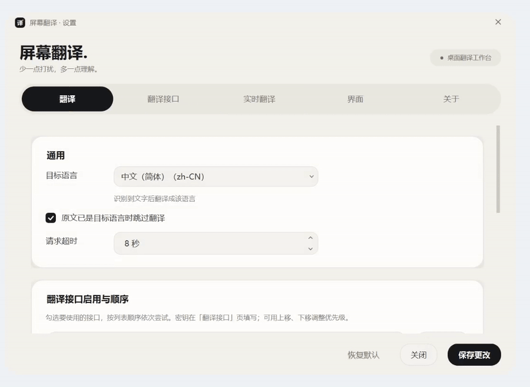
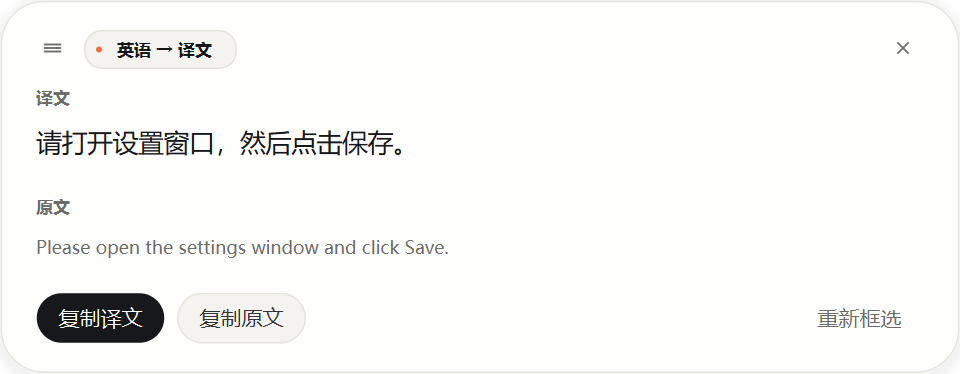
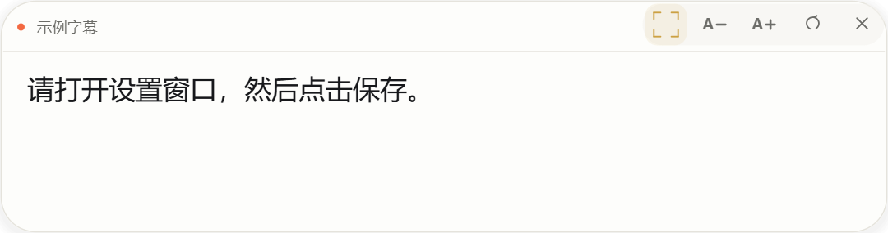

# ScreenTranslator · 螢幕翻譯

**框選螢幕上的文字，或讓字幕持續自動翻譯。**

A Windows screen translator with local OCR, region selection, live subtitles, and configurable translation providers.



## 能做什麼

| 功能 | 使用方式 |
| --- | --- |
| 框選翻譯 | 點擊懸浮入口，拖出選區；辨識後顯示譯文卡片 |
| 即時翻譯 | 固定取景區域，文字變化後自動辨識並更新譯文，適合字幕、網頁和遊戲介面 |
| 本地 OCR | RapidOCR + ONNX Runtime，在本機辨識螢幕文字 |
| 多種翻譯服務 | DeepL、百度、Azure Translator、OpenAI 相容介面、自訂 HTTP，以及 MyMemory / Google 適配器 |
| 優先順序與失敗回退 | 啟用多個服務並調整順序，失敗後依次嘗試 |
| 可錄製的譯文視窗 | 可設定錄影、投影或遠端桌面顯示譯文；擷取下層視窗，不支援時自動分開取景與譯文 |
| 閱讀與操作 | 調整字級、背景透明度、原文顯示；複製原文或譯文 |

懸浮入口常駐桌面，可拖動。右鍵開啟設定、即時翻譯視窗或結束程式。

## 圖片與示範影片



**[觀看 / 下載完整示範影片（1080p · 60fps MP4）](docs/media/demo.mp4)**

影片使用實際 Qt 介面、範例原文和預設譯文製作，用於展示操作，不代表網路翻譯速度。

| 翻譯結果 | 即時譯文 |
| --- | --- |
|  |  |

## 安裝與啟動

### Windows 安裝版（建議）

適用於 **Windows 10 1809 以上 / Windows 11，x64**。安裝包已包含執行環境與 OCR 模型，**不需要另外安裝 Python**。

1. 前往 [Releases](https://github.com/OsKamio/screen-translator/releases)，下載 `ScreenTranslator-0.2.0-Setup-x64.exe`。
2. 執行安裝程式，選擇安裝位置；需要時勾選建立桌面捷徑。
3. 從開始功能表或桌面開啟 **ScreenTranslator**，螢幕上會出現「譯」字懸浮入口。
4. 右鍵懸浮入口 → **設定**，選擇目標語言和翻譯服務，填入該服務需要的設定並儲存。

目前為 **0.2.0 私有審閱版**，安裝包尚未進行程式碼簽章。倉庫與版本仍在確認階段，下載需要有倉庫存取權限。OCR 可離線執行，線上翻譯需要網路與可用的翻譯服務。

更新時先從懸浮入口右鍵選單結束程式，再執行新版安裝包。解除安裝可在 Windows「設定 → 應用程式」找到 ScreenTranslator；已儲存的翻譯服務設定會保留。

### 免安裝版

下載 `ScreenTranslator-0.2.0-Portable-x64.zip`，**完整解壓縮**後，執行資料夾內的 `ScreenTranslator.exe`。請保留同資料夾中的擷取程式與 `_internal` 目錄。此版本同樣使用目前 Windows 使用者的設定。

### 從原始碼啟動

開發或修改程式時可使用原始碼。建議 Python **3.12**，在專案目錄開啟 PowerShell：

```powershell
py -3.12 -m venv .venv
.venv\Scripts\python.exe -m pip install -r requirements.txt
.\run.bat
```

也可直接執行 `.venv\Scripts\python.exe main.py`。Python 3.13 安裝 RapidOCR 時可能需要 `--ignore-requires-python`；優先使用 Python 3.12 的常規安裝方式。

## 第一次使用

1. 單擊懸浮入口並拖出選區，鬆開後辨識並翻譯；按 Esc 取消框選。
2. 譯文卡片支援複製、查看原文和重新框選。
3. 右鍵懸浮入口開啟設定，選擇目標語言、翻譯服務與優先順序。

預設公共適配器的可用性受網路與服務政策影響；若無法使用，可設定自己的翻譯服務。

### 即時字幕與連續翻譯

右鍵懸浮入口 → **即時翻譯視窗**，調整位置和大小，使取景區域覆蓋需要辨識的文字。

- 畫面變化後辨識；重複字幕使用短期記憶體快取。
- 工具列支援黃框開關、字級調整、立即重新整理與隱藏；右鍵可暫停、重新選區或恢復覆蓋顯示。
- 需要錄影、投影或遠端桌面顯示譯文時，在設定中關閉「不被截圖 / 錄影 / 投影擷取」。
- 不支援直接讀取下層應用程式時，自動將譯文移到原文旁邊，保留原取景區域。

擷取效果會受應用程式與系統影響；受保護視窗、混合 DPI 多螢幕等情境仍需進一步驗證。

## AI 製作說明

本專案在作者提出需求、提供參考和實際使用回饋的基礎上，使用 AI 工具輔助完成程式碼、介面、文件與示範素材製作。功能持續依測試結果和使用回饋修正。
